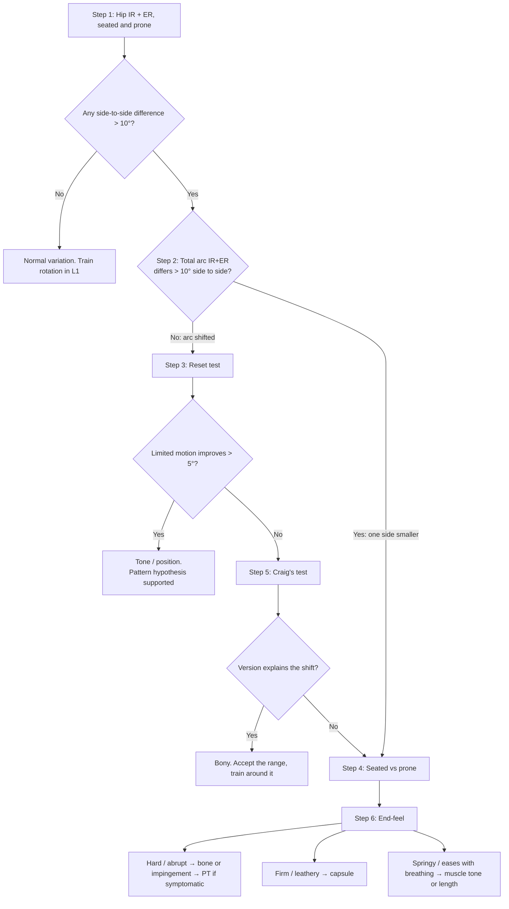

## Basics

Use this when hip rotation differs side to side, e.g. limited left IR and limited right ER. It separates bone (femoral version), capsule, muscle, and pelvic position or tone, using repeatable measurements instead of palpating pelvic landmarks.

General rules are in [[T0 - How to troubleshoot]].

## Steps

### 1. Baseline

Run the four hip rotation tests from [[L0 - Lower Body Mobility Assessment]]:
- `hip-internal-rotation`
- `hip-external-rotation`
- `hip-internal-rotation-prone`
- `hip-external-rotation-prone`

That gives 8 numbers: IR and ER for each side, seated and prone.

- Every side-to-side difference ≤ 10° → **normal variation**. Stop here.
- Any difference > 10° → continue.

### 2. Total arc

Compute IR + ER for each side, in each position.
- **Totals similar (≤ 10° apart) but the split is shifted**, e.g. the left has less IR but more ER → the hip isn't stiffer, it's oriented differently. Suspect femoral version or pelvic position/tone. → Step 3.
- **One side's total is clearly smaller** → real loss of range. Suspect capsule or muscle. → Step 4.

### 3. Reset test

Do one 2–3 minute positional reset. Always use the same one:
- 90/90 hip-lift breathing: feet on the wall, slight posterior pelvic tilt, full exhales.
- Or a drill targeting the suspected pattern, e.g. a left-side hip-shift drill for Left AIC.

Then immediately remeasure the asymmetric tests.
- **Improves > 5°** → **tone or position**. The pattern hypothesis is supported, for you.
  - Program: use the reset as a warm-up, then load the new end range with the [[A3 - How to improve mobility]] process so it sticks.
  - On retest, check whether the *pre-reset* baseline drifts toward symmetry.
- **No change** → Step 5.

### 4. Seated vs. prone

Compare where the limit is bigger. See also *Reading hip rotation in flexion vs. extension* in [[L0 - Lower Body Mobility Assessment]].

| Pattern | Likely tissues |
| --- | --- |
| IR limited mainly **seated** | Posterior capsule, deep rotators (piriformis, obturators), glute max |
| IR limited mainly **prone** | Anterior capsule/ligaments, deep rotators in their shortened range |
| ER limited mainly **seated** | Anterior/medial structures, adductors, TFL |
| ER limited mainly **prone** | Anterior capsule, iliopsoas, TFL |
| Similar in both | Capsule overall, or bone. Check end-feel. |

This narrows things down; it doesn't confirm them. → Step 6.

### 5. Craig's test (femoral version)

**Setup:** Lie face down, knee bent to 90°.

**Do:** Feel the greater trochanter (the bony point on the outside of the hip) while rotating the leg. Find the point where it's most prominent to the side, then measure the shin angle from vertical.
- **Shin rotated outward** at that point (hip in IR) → **anteversion**, which shifts the arc toward IR.
- **Shin near vertical or rotated inward** → **neutral or retroversion**, which shifts the arc toward ER.

Agreement with imaging is moderate, so treat this as an estimate.

**Branch:**
- The version difference matches the arc shift → **bony**. Accept the range and train strength within it.
- It doesn't explain the shift → Step 4.

### 6. End-feel

Gently take the limited motion to end range passively and note what the stop feels like:
- **Hard or abrupt**, sometimes with a pinch in the front of the hip → **bone or impingement**. If symptomatic, see a PT (possible FAI). Don't force it.
- **Firm and leathery**, the same rep to rep → **capsule**. Program: long end-range holds under load and banded joint distraction. Expect weeks to months.
- **Springy, or eases when you relax and breathe** → **muscle tone or length**. Program: the [[A3 - How to improve mobility]] process.

## App notes

- Steps 1–2 take about 5 minutes, Step 3 adds about 5, and the full tree takes about 15.
- Steps 1 and 2 reuse existing app test IDs, so a normal L0 retest can trigger this session automatically.

## References

- Ruwe PA et al. (1992). Clinical determination of femoral anteversion: a comparison with established techniques. *JBJS Am* 74(6):820–830.
- Tullberg T et al. (1998). Manipulation does not alter the position of the sacroiliac joint. *Spine* 23(10):1124–1128.
- van der Wurff P et al. (2000). Clinical tests of the sacroiliac joint: a systematic methodological review. Part 1: Reliability. *Manual Therapy* 5(1):30–36.
- Stovall BA, Kumar S (2010). Reliability of bony anatomic landmark asymmetry assessment in the lumbopelvic region. *JAOA* 110(11):667–674.
- Laslett M et al. (2005). Diagnosis of SIJ pain: validity of individual provocation tests and composites. *Manual Therapy* 10(3):207–218. Pain-provocation cluster; useful if SIJ pain is the question rather than position.
