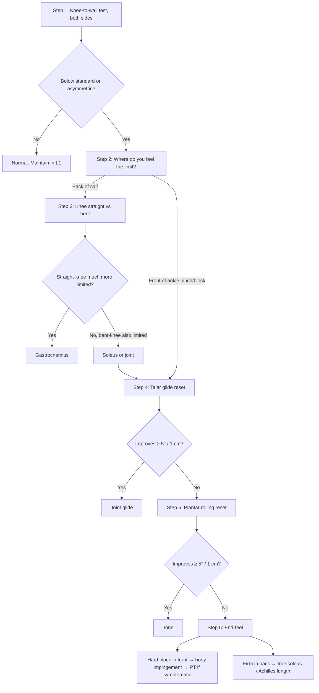

## Basics

Use this when `ankle-dorsiflexion-wall` fails or is asymmetric. It separates calf length (gastrocnemius vs. soleus), joint glide (the talus not sliding back), tone, and bone. Restricted talar glide is especially common after old ankle sprains.

General rules are in [[T0 - How to troubleshoot]].

## Steps

### 1. Baseline

Run `ankle-dorsiflexion-wall` from [[L0 - Lower Body Mobility Assessment]] on both sides. Record the shin angle and the toe-to-wall distance.
- **Continue** if either side is below 35°, or the sides differ by more than 5° (~1.5 cm).
- Otherwise → **normal**. Stop here.

The knee-to-wall test is one of the most reliable tests in the battery (ICC ~0.9+), with noise of about 1 cm.

### 2. Where's the limit?

At end range, where do you feel the stop?
- **Back of the calf or Achilles** (a stretch) → soft tissue → Step 3.
- **Front of the ankle** (a pinch, block or jammed feeling) → joint or bone → Step 4.
- **Both, or unsure** → do Step 3, then Step 4.

### 3. Knee straight vs. bent

Run the **straight-knee calf stretch** follow-up from [[L0 - Lower Body Mobility Assessment]] and compare it with the bent-knee result from Step 1. The gastrocnemius crosses the knee and the soleus doesn't, so straightening the knee only tensions the gastrocnemius.
- **Straight-knee is much more limited** (a bigger bent-vs-straight gap than on the other side, or more than ~10–15°) → **gastrocnemius**.
  - Program: the [[A3 - How to improve mobility]] process with the knee straight, e.g. deficit calf raises off a step, straight knee, with a pause at the bottom.
- **Bent-knee is limited too** → **soleus or joint**. Run Step 4 to rule out the joint before calling it soleus.

### 4. Talar glide reset

Dorsiflexion needs the talus to glide *backward* in the ankle joint. A pinch at the front of the ankle is the typical sign that it isn't.

**Do:** a weight-bearing mobilization with movement.
1. Loop a heavy band low around the front of the ankle, just below the ankle bones, anchored behind you so it pulls the ankle **backward**.
2. In half-kneeling, slowly rock the knee forward and back over the toes.
3. Do 3 × 10.

Then immediately repeat Step 1.
- **Improves ≥ 5° (or ~1 cm)**, and/or the front pinch is reduced → **joint glide**.
  - Program: the banded mobilization as a daily warm-up, then end-range loading to keep the gain: knee-over-toe split squats, loaded lunge holds, tibialis raises.
- **No change** → Step 5.

### 5. Plantar rolling reset

The plantar fascia connects to the calf through the heel. Rolling the sole sometimes gives a small, short-lived gain in range, likely from reduced tone rather than any change in tissue.

**Do:** roll the arch on a lacrosse or tennis ball for 2 minutes, firm pressure, heel to forefoot.

Then repeat Step 1.
- **Improves ≥ 5° (or ~1 cm)** → **tone**. Program: rolling as a warm-up only, plus the loading work from Step 3 or 4 so the gain lasts.
- **No change** → Step 6.

Vary the order of Steps 4 and 5 across sessions so their effects aren't confused (see the warm-up control in [[T0 - How to troubleshoot]]).

### 6. End-feel

Sit with the knee bent and pull the foot into dorsiflexion with your hand or a strap. Note what the stop feels like:
- **Hard, abrupt block at the front**, sometimes painful → **bony impingement**, e.g. bone spurs after an old sprain. If symptomatic, see a PT or get imaging. Don't force the range.
- **Firm stop at the back**, unchanged by all the resets → **true soleus or Achilles length**. Program: heavy, slow deficit calf raises with the knee bent and straight, with long holds at the bottom. Expect weeks to months.

## App notes

- Steps 1–3 take about 5 minutes, each reset adds 3–4, and the full tree takes 15–20.
- Steps 1 and 3 reuse existing L0 tests. Store the reset order with each session.

## References

- Bennell K et al. (1998). Intra-rater and inter-rater reliability of a weight-bearing lunge measure of ankle dorsiflexion. *Aust J Physiother* 44(3):175–180.
- Hoch MC, McKeon PO (2011). Normative range of weight-bearing lunge test performance asymmetry in healthy adults. *Manual Therapy* 16(5):516–519.
- Vicenzino B et al. (2006). Initial changes in posterior talar glide and dorsiflexion of the ankle after mobilization with movement in individuals with recurrent ankle sprain. *JOSPT* 36(7):464–471.
- DiGiovanni CW et al. (2002). Isolated gastrocnemius tightness. *JBJS Am* 84(6):962–970.
