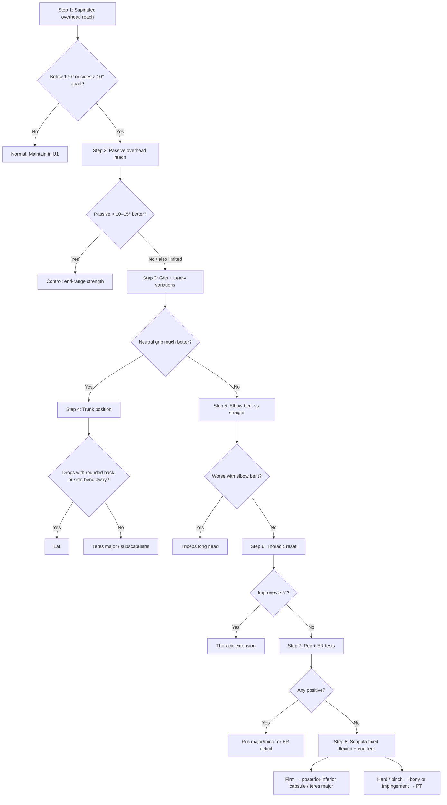

## Basics

Use this when `supinated-overhead-reach` fails or is asymmetric. It separates control, lat, teres major/subscapularis, triceps long head, thoracic spine, pecs, ER deficit, and the joint capsule.

The trick is to change the position of whatever each tissue crosses:
- **Lat:** spans arm → trunk → pelvis. Tensioned by rounding the low back, posterior pelvic tilt, and side-bending away.
- **Teres major and subscapularis:** span arm → shoulder blade only. Trunk position doesn't affect them.
- **Lat, teres major, subscapularis together:** they all rotate the arm inward, so the supinated grip in the baseline test tensions all three.
- **Triceps long head:** crosses the elbow. Tensioned by bending the elbow.

Most fake overhead range comes from arching the low back and flaring the ribs, so keep the low back flat on every measure.

General rules are in [[T0 - How to troubleshoot]]. Several causes at once are common here.

## Steps

### 1. Baseline

Run `supinated-overhead-reach` from [[U0 - Upper Body Mobility Assessment]] on both sides.
- **Continue** if either side is below 170°, or the sides differ by more than 10°.
- Otherwise → **normal**. Stop here.

Also note any compensations: rib flare, the arm drifting out to the side, a bent elbow, or the head poking forward.

### 2. Active vs. passive (control vs. length)

Run the **passive overhead reach** follow-up (`supine-overhead-reach`) from [[U0 - Upper Body Mobility Assessment]].
- **Passive is more than ~10–15° better than active** → **control**. The range is there but you can't reach it under your own power.
  - Program: end-range strength, i.e. RAILs and step 4 of [[A3 - How to improve mobility]]. Examples: wall slides with lift-off, prone Y raises, serratus wall slides.
  - If passive is also below standard, keep going with the remaining steps.
- **Passive is also limited** → length or joint → Step 3.

### 3. Grip and Leahy variations

**Grip comparison:** repeat Step 1 with a neutral (thumb-up) grip instead of supinated.
- **Much better with a neutral grip** (> 10°) → one of the internal rotators (lat, teres major, subscapularis) → Step 4.
- **No real difference** → not those → Step 5.

**Isolated Leahy tests:** use the variations in the [[U0 - Upper Body Mobility Assessment]] follow-ups (lats, pec major, subscapularis / teres major) as a second opinion.

### 4. Trunk position (lat vs. teres major / subscapularis)

Repeat the passive overhead reach in two trunk positions and compare each with Step 2:
1. **Rounded low back:** knees pulled toward the chest (posterior pelvic tilt). This is Matthew Smith's lat test, done lying down. A seated slump works too.
2. **Side-bend away:** bend the trunk away from the test arm, then reach overhead.

**Branch:**
- **Reach drops more than ~10°** in either position, or clearly more than on the other side → **lat**.
  - Program: the [[A3 - How to improve mobility]] process in a lat-lengthened position (e.g. a bench prayer stretch with a rounded back), then loaded work at end range (straight-arm pullovers in posterior tilt, deep-hang pull-ups).
- **Trunk position makes little difference** → **teres major or subscapularis**.
  - Program: the same process in flexion plus ER, with the shoulder blade pinned.

### 5. Elbow bent vs. straight (triceps long head)

Do the passive overhead reach with the elbow **straight**, then with it **fully bent** (hand toward the shoulder blade).
- **More limited with the elbow bent** (by more than ~10°) → **triceps long head**.
  - Program: full-range overhead triceps extensions and long-length PAILs/RAILs.
- **No difference** → Step 6.

### 6. Thoracic extension reset

Getting the arm fully overhead takes about 10–15° of upper-back extension. A stiff thoracic spine caps overhead reach, and the low back arches to make up for it. It's also worth cross-checking T-spine rotation in [[U0 - Upper Body Mobility Assessment]].

**Do:** 2 minutes of thoracic extension over a foam roller, one segment at a time, hands behind your head and low back neutral.

Then immediately repeat Step 1.
- **Improves ≥ 5°** → **thoracic extension**.
  - Program: thoracic extension PAILs/RAILs, then loaded extension (prone T-spine extension holds, overhead carries with a braced trunk).
- **No change** → Step 7.

### 7. Pec and ER

Check the existing tests in [[U0 - Upper Body Mobility Assessment]]:
- **`prone-pec-length`** (and the bench version if it stalls).
  - Pec minor pulls the shoulder blade forward, which blocks the upward rotation and backward tilt it needs overhead.
  - Pec major limits flexion, especially with the arm rotated outward and slightly out to the side.
- **`shoulder-external-rotation-supine`.** The arm has to rotate outward to clear the top of the shoulder overhead. Limited ER often shows up as the arm drifting out to the side, or a pinch at the top of the shoulder.

**Branch:**
- **Any positive** → train it, then retest overhead reach to confirm it was the bottleneck.
- **All negative** → Step 8.

### 8. Scapula-fixed flexion and end-feel

**Do:** lie on your back. A partner pins the outer border of the shoulder blade (or you weight it into the floor), then measures passive flexion. Glenohumeral flexion with the scapula fixed is normally about 120°. Compare sides.
- **Firm stop**, felt in the armpit or the back of the shoulder, and unaffected by trunk position → **posterior-inferior capsule or teres major**.
  - Program: end-range work in flexion + ER, a banded inferior glide, then loaded overhead work in a limited range. Expect weeks.
- **Hard or abrupt stop, or a pinch at the top of the shoulder** → **bony or impingement**. See a PT and don't force the range.

## App notes

- Steps 2, 5 and 8 work best with a partner. Mark them in the UI, or offer the gravity-assisted solo versions.
- Each measurement should include a "low back stayed flat?" confirmation checkbox.
- Steps 1–4 take about 8 minutes, and the full tree takes 15–20.

## References

- Kendall FP et al. *Muscles: Testing and Function with Posture and Pain*, 5th ed. Shoulder flexion / lat length test.
- Borstad JD, Ludewig PM (2005). The effect of long versus short pectoralis minor resting length on scapular kinematics. *JOSPT* 35(4):227–238.
- Crosbie J et al. (2008). Scapulohumeral rhythm and associated spinal motion. *Clinical Biomechanics* 23(2):184–192. *(verify)*
- Edmondston SJ et al. (2012). Thoracic spine extension mobility in young adults: influence of subject position and spinal curvature. *JOSPT* 42(3):266–274. *(verify)*
